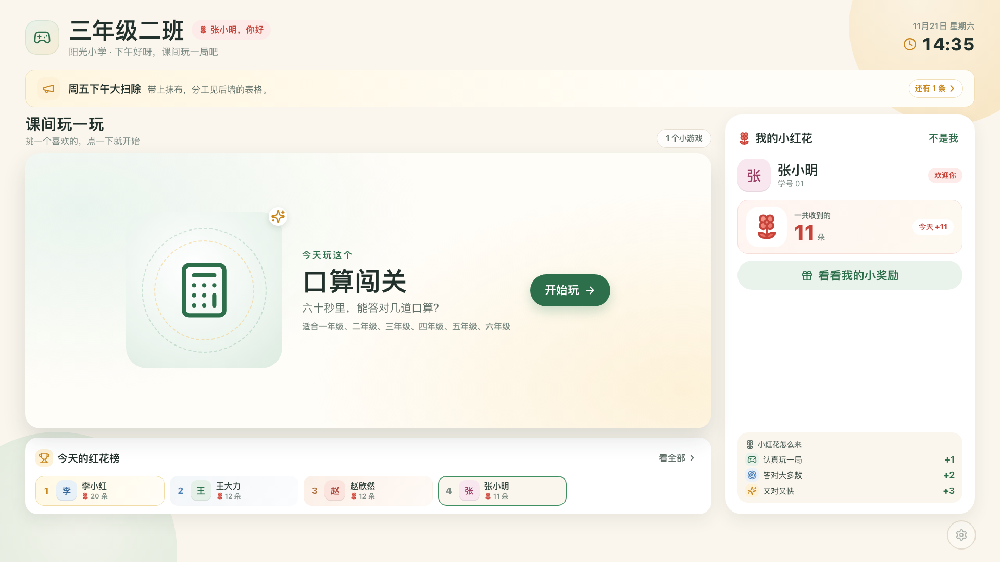
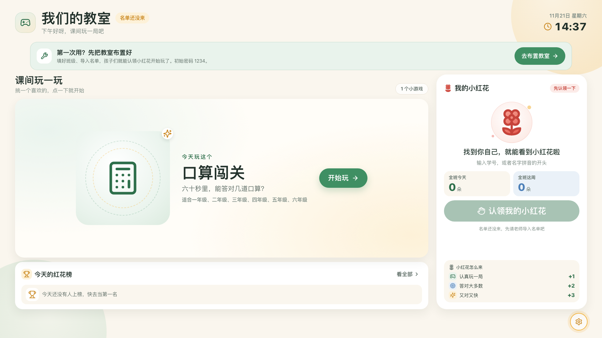
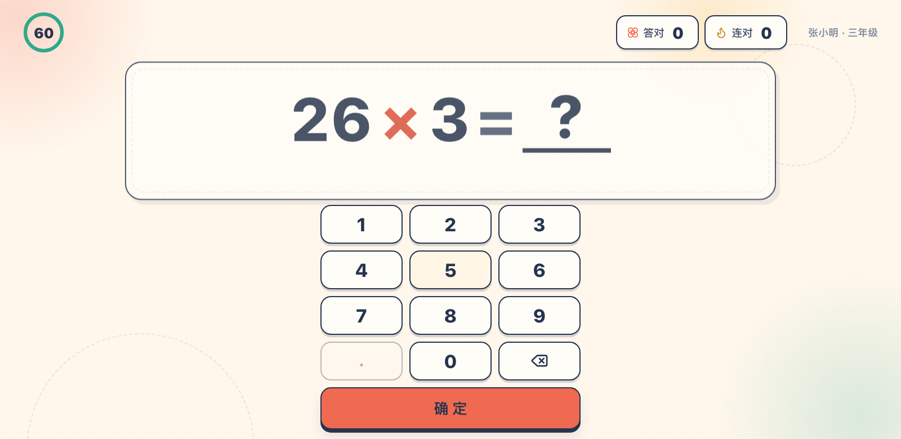
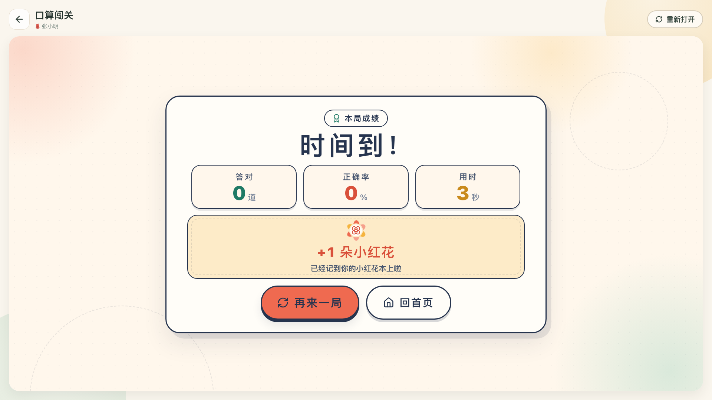
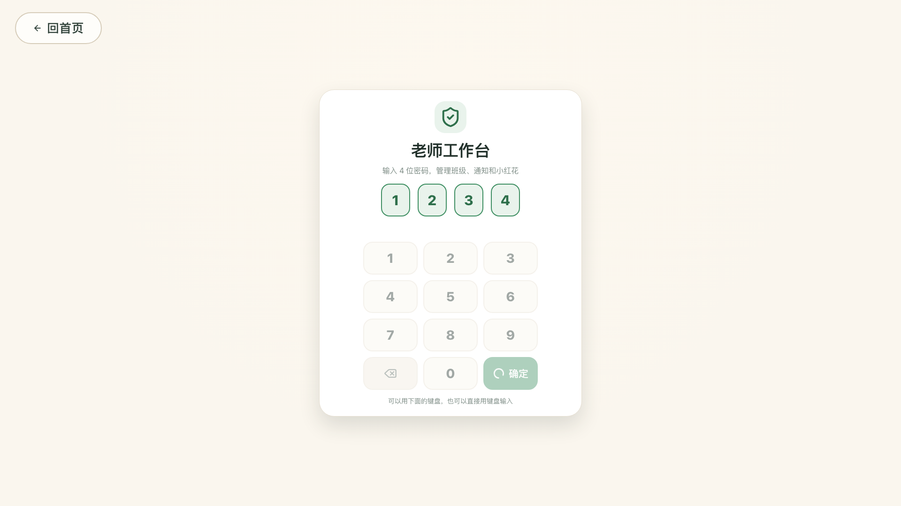
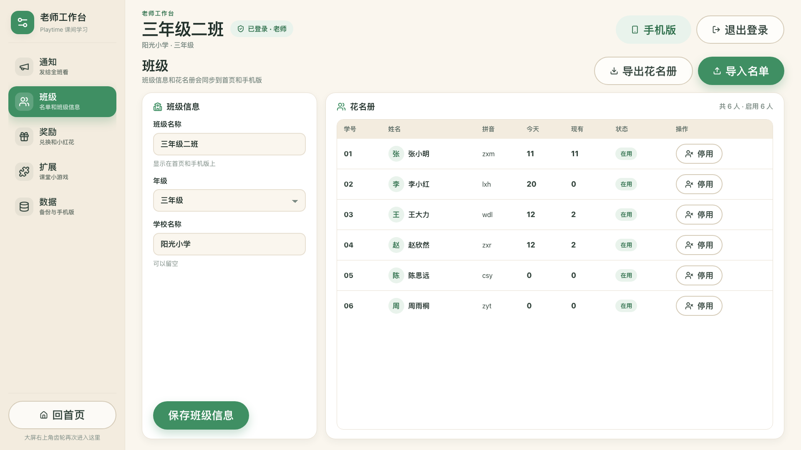
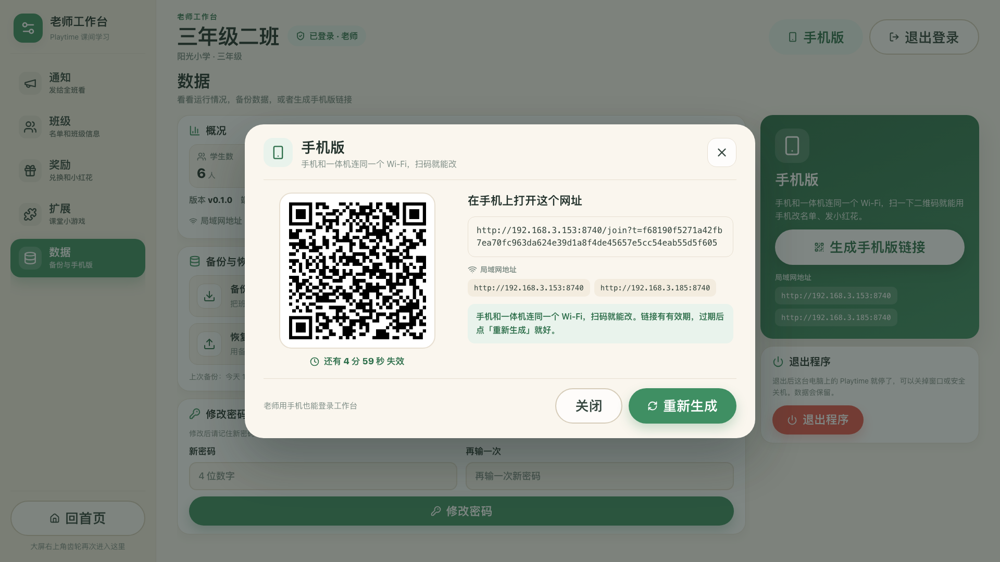
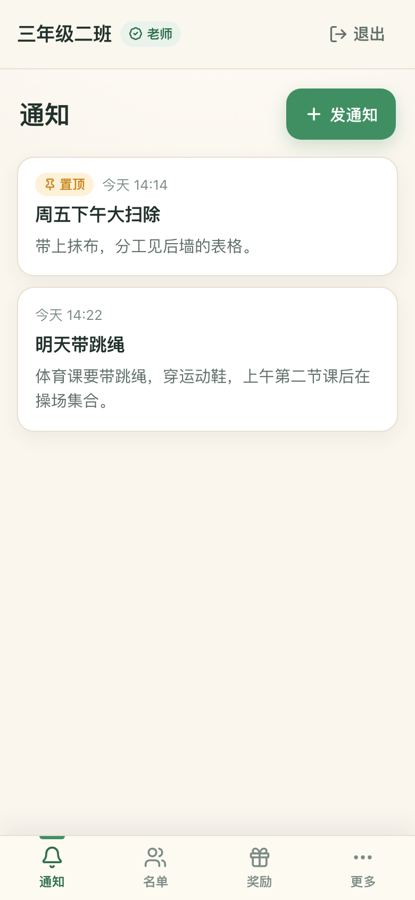
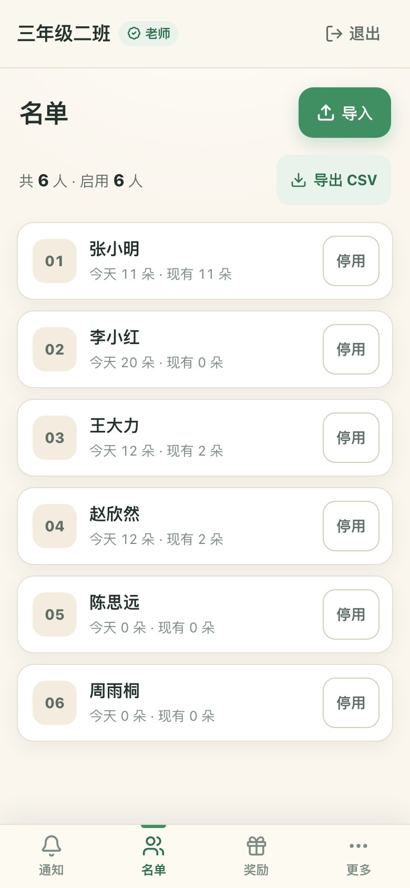
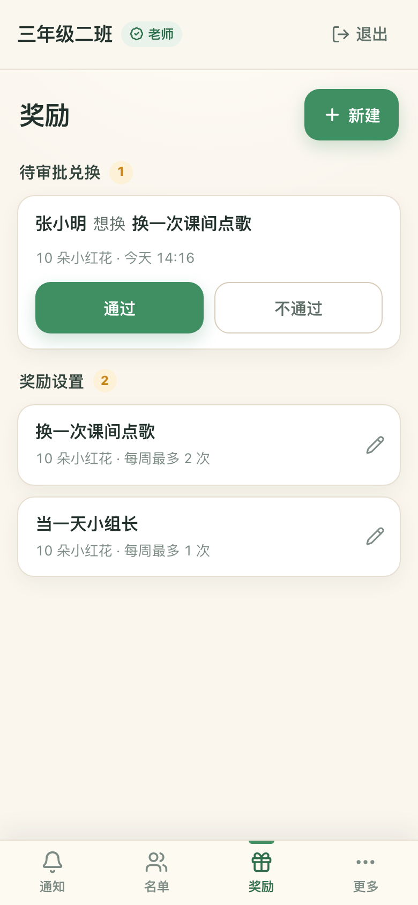

# Playtime

教室一体机上的课间学习乐园。孩子们用学号认领自己，玩一局知识小游戏，赢小红花；老师在班主任工作台发通知、管名单、设奖励、批兑换。

## 怎么装

- **Windows**：双击 `playtime-windows-amd64.exe`，会自动用 Edge 全屏打开，第一次打开按提示建班级、导名单、设 4 位密码。
- **Android**：安装 `playtime-android.apk`，打开即全屏横屏运行。
- 数据全部存在本机（Windows 为 exe 同目录的 `data` 文件夹，Android 为应用私有目录），不上传任何地方。

## 怎么用

1. 首页点一个游戏，输学号或拼音开头认领自己。
2. 玩完看到自己得了几朵小红花，攒够了可以在大屏上兑换奖励，等老师确认。
3. 老师点首页右上角齿轮，输 4 位密码进工作台：发通知、导名单、设奖励、看数据、装扩展。
4. 工作台里点「手机版」，会出现二维码，用手机扫一下就能在手机上改通知、名单和奖励。

## 界面

大屏首页：班级、当天通知、游戏墙、红花榜，右侧是孩子自己的小红花。

第一次打开会提示先布置教室：

口算闯关（60 秒，数字键盘作答）：

玩完自己看到得了多少朵：

老师工作台（大屏右上角齿轮进，输 4 位密码）：

花名册与班级信息：

手机上改通知、名单、奖励（工作台点「手机版」出二维码，扫一下就进）：

| 手机版通知 | 手机版名单 | 手机版奖励 |
| --- | --- | --- |
|  |  |  |

## 扩展

口算闯关是内置的。想要更多小游戏，让会写代码的同事照着 [扩展接口文档](docs/plugin-api.md) 写一个，提 PR 登记到 `plugins/index.json`，教室里点一下就能装。

## 许可

AGPL-3.0，见 [LICENSE](LICENSE)。
